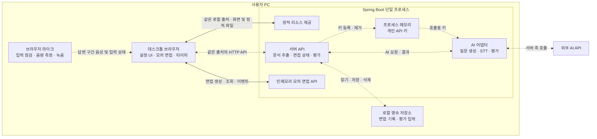

# AI Interview Loop 아키텍처

이 문서는 `dev`에 병합된 면접 설정 및 모의 진행 구현과 [MVP 기획서](mvp-spec.md), 수락된 ADR을 기준으로 작성했다. 기능 진행과 병합 상태는 [로드맵](roadmap.md)에서 관리한다.

## 1. 시스템 개요

AI Interview Loop는 사용자 PC에서 실행하는 한국어 모의 면접 웹 앱이다. 브라우저는 `localhost`에서 면접 화면을 열고, Spring Boot는 화면 파일과 백엔드 API를 같은 출처에서 제공한다. MVP 실행 환경은 로컬 PC다. 목표 구조에서 외부 AI API는 Spring Boot가 사용자 개인 키를 사용해 호출한다.

| 구분 | 범위 |
|---|---|
| 구현됨 | Spring Boot 정적 리소스 제공과 브라우저의 면접 설정 화면. 지원 자료 파일 선택, 마스킹된 키 입력, 답변 시간 설정, 모의 질문과 타이머, 면접 상태 API, 모의 평가 요청 상태. [PR #5](https://github.com/jution113/ai-interview-loop/pull/5) |
| 확정된 목표 | 문서 텍스트 추출, 질문 생성·필터링, 브라우저 음성 수집, 일괄 STT, 로컬 기록 저장·복기와 실제 평가 및 재시도. |
| 미확정 | 로컬 저장 기술, AI 공급자, 실제 음성·평가 연동의 세부 API 계약 등. 7절에 정리한다. |

## 2. 기술 스택

| 구분 | 현재 구성 |
|---|---|
| 백엔드 | Java 21, Spring Boot 4.2.0, Spring MVC 및 Validation 의존성. [Gradle 빌드 설정](../backend/build.gradle) |
| 프런트엔드 | HTML, CSS, 브라우저 JavaScript 모듈. Gradle `processResources`가 설정 및 면접 화면과 공통 CSS·JavaScript를 Spring Boot 정적 리소스에 포함한다. [화면 진입점](../frontend/index.html) |
| 빌드 | Gradle Wrapper 9.9.2. 화면 파일은 별도 프런트엔드 빌드 없이 제공한다. [Wrapper 설정](../backend/gradle/wrapper/gradle-wrapper.properties) |
| 검증 | JUnit Platform과 Spring Boot 테스트로 컨텍스트와 정적 리소스 응답을 확인한다. Playwright는 모의 설정 흐름을 브라우저에서 검증하는 개발 의존성이다. [백엔드 테스트](../backend/src/test/java/io/github/jution113/ai_interview_loop) · [브라우저 테스트](../frontend/tests/setup.spec.js) |

## 3. 전체 시스템 구성도

실선은 현재 구현된 연결이고, 점선은 목표 구조의 연결이다. 서버 API와 AI 어댑터는 같은 Spring Boot 프로세스 안의 논리적 책임으로 표시했다.

## 4. 주요 컴포넌트와 책임

| 컴포넌트 | 구현된 책임 | 확정된 목표 책임 |
|---|---|---|
| 웹 UI와 브라우저 | 설정 폼과 필수 파일 검증, 질문과 타이머 표시, 조기 답변·답변 완료·종료 이벤트 전달, 새로고침 시 면접 상태 복원. | 설정·면접·결과 표시, 타이머 표시 및 사용자 이벤트 전달, 마이크 권한 확인, 음량 측정과 답변 구간 녹음. |
| Spring Boot | 정적 파일 제공 및 `/api/interviews`에서 인메모리 모의 면접 생성·조회·상태 전이. | 지원 자료 텍스트 추출, 면접 진행 상태 확정, AI 연동과 오류 처리, 면접 기록 열람·삭제 및 평가 재시도 요청 처리. |
| AI 어댑터 | 구현 전. | 서버에서 질문 생성, STT, 평가 요청을 처리한다. 기획서의 권장 구조에서 이 기능들은 분리된 어댑터 책임이다. |
| 로컬 기록 저장 | 구현 전. | 완료 문답, 평가에 필요한 기업·직무 자료와 적용한 평가 기준을 영속 저장한다. |
| 개인 API 키 관리 | 화면 입력칸에서 마스킹한다. 모의 제출에서 키를 전송하거나 영속 저장하지 않는다. | Spring Boot 메모리에서 사용자 키를 관리하고 외부 AI API 호출에 사용한다. |

현재 UI의 제출 및 입력 검증 로직은 [setup.js](../frontend/setup.js)에 있다.

## 5. 핵심 데이터 흐름

### 현재 구현

1. 브라우저가 루트 페이지와 정적 파일을 요청하고 Spring Boot가 응답한다.
2. 브라우저에서 필수 파일을 확인한 뒤 면접 화면으로 이동하고 선택한 답변 시간으로 모의 면접을 생성한다. 파일과 키는 서버에 전달하지 않는다.
3. 서버가 질문과 단계·남은 시간을 반환한다. 브라우저가 상태 버전과 사용자·타이머 이벤트를 보내면 서버가 전이를 확정한다. 마지막 답변 뒤 모의 평가 요청 상태를 표시한다.

### 확정된 MVP 흐름

1. **설정과 준비.** 필수 지원 자료를 첨부하고 추출한 기업·직무 정보를 확인한다. 면접 시작 전에 추출 텍스트와 음성의 외부 전송 여부를 안내한다. 핵심 질문은 5개를 목표로 준비하며, 유효한 핵심 질문이 0개면 시작하지 않는다.
2. **질문과 수집.** 화면 표시 전에 질문을 검증한다. 질문 텍스트 표시 즉시 10초 준비를 시작하고, 시간이 끝나거나 사용자가 ‘바로 답변’을 누르면 답변 음성을 수집한다. 답변 제한 시간의 기본값은 60초이며 60·90·120초 중 선택한다.
3. **변환과 다음 질문.** 답변 완료 또는 타이머 만료로 수집을 끝내고 일괄 STT를 요청한다. STT가 완료될 때마다 문답을 저장한다. 추가 확인이 필요하면 꼬리질문을 생성한다. 생성 실패나 필터 차단에는 자동 재시도를 적용하고, 한도를 소진한 질문은 질문 수와 평가에서 제외한 뒤 진행한다.
4. **평가와 복기.** 정상 종료 시 기록과 평가 입력의 저장을 마친 뒤 평가한다. 수동 종료 시에는 요청이 있을 때 저장된 문답으로 피드백을 제공한다. 부적절하다고 판정한 질문과 답변은 채점에서 제외하고, 채점 대상 답변이 0개면 점수 없이 안내한다.
5. **복구.** 오류로 중단된 면접의 저장된 문답은 열람할 수 있다. 정상 종료 후 평가가 실패한 경우에는 기존 기록으로 평가만 다시 요청할 수 있다. 백엔드가 재시작된 경우 API 키를 다시 입력한다.

## 6. 상태 관리 및 데이터 수명주기

브라우저는 폼과 화면 상태를 관리한다. 모의 면접 진행·평가 요청 상태는 백엔드 메모리에 있으며, 새로고침 시 면접 ID로 조회하고 서버 재시작 시 사라진다. 실제 평가와 영속 기록의 수명주기는 아래 목표 정책을 따른다.

| 상태·데이터 | 주체와 수명 |
|---|---|
| 화면·타이머 | 브라우저가 표시와 사용자 이벤트 전달을 담당한다. 화면에는 백엔드가 확정한 진행 상태를 반영한다. |
| 면접 진행 상태 | 백엔드가 현재 질문, 답변 접수, 다음 질문과 종료를 확정한다. 타이머 만료와 답변 완료가 겹쳐도 같은 답변 접수와 다음 상태 전환을 한 번만 처리한다. |
| 평가 상태 | 면접 진행과 독립적으로 요청·성공·실패·재시도를 관리한다. 정상 종료된 면접의 평가 재시도에는 저장된 입력을 사용한다. |
| 개인 API 키 | Spring Boot 프로세스 메모리에만 둔다. 면접 종료나 평가 실패 후에도 유지하며, 사용자가 제거하거나 프로세스가 종료되면 사라진다. 코드·로그·API 응답·영속 저장소에 남기지 않는다. |
| 원본 답변 음성 | STT 처리에 필요한 동안 임시로 유지한다. 실패 후 재시도에 필요한 경우 잠시 보관하며 성공·오류 단계 건너뛰기·세션 종료 시 앱 내부 사본을 삭제한다. 외부 AI 공급자의 데이터 보관 정책은 별도로 안내한다. |
| 문답과 평가 입력 | 완료 문답, 필요한 기업·직무 자료와 평가 기준을 로컬에 영속 저장한다. 저장된 기록은 백엔드 재시작 후 열람·삭제할 수 있다. 오류 중단된 면접의 이어하기와 부분 평가는 MVP에서 제외한다. |

## 7. 미확정 사항

- 실제 마이크·STT·평가 처리와 진행 이벤트의 연결, 데이터별 처리 위치와 보존 기간.
- 영속 저장 기술과 스키마, 문답 저장 실패와 동시 요청 처리, 평가 중 기록 삭제 및 늦게 도착한 응답 처리.
- 브라우저에서 백엔드로 키를 전달하는 방법, AI 공급자·모델, 문서 추출 라이브러리와 입력 한도.
- 녹음 포맷과 음성 전달·임시 보관 방법, 음량 측정 및 저음량 경고 기준.
- 질문 필터의 판정 방식과 자동 재시도 횟수, 미평가 영역의 점수 집계 방식, 평가 근거 검증 기준.

검토 시점과 검증 계획은 [로드맵](roadmap.md)에 따른다.

## 8. 관련 ADR

| ADR | 적용 범위 |
|---|---|
| [0001 · 로컬 실행형 웹 애플리케이션](adr/0001-local-web-application.md) | 사용자 PC와 로컬 접속 |
| [0002 · 모노레포](adr/0002-monorepo.md) | `backend/`, `frontend/`, `docs/` 소스 구조 |
| [0003 · 답변 종료 후 일괄 STT](adr/0003-batch-stt-after-answer.md) | 음성 변환 시점 |
| [0005 · 면접 기록과 최종 평가 재시도](adr/0005-interview-record-and-evaluation-retry.md) | 문답 저장, 중단 기록 열람과 평가 복구 |
| [0006 · 백엔드 실행 중 API 키 유지](adr/0006-process-lifetime-api-key.md) | 키의 보관 위치와 수명 |
| [0007 · 질문 생성 실패 시 자동 재시도](adr/0007-question-generation-recovery.md) | 질문 재생성, 한도 소진 후 진행과 평가 제외 |
| [0008 · 면접 진행 상태의 백엔드 확정](adr/0008-interview-state-ownership.md) | 브라우저와 백엔드의 상태 책임 |
| [0009 · Spring Boot의 정적 리소스 제공](adr/0009-serve-frontend-from-spring-boot.md) | 같은 로컬 출처에서 화면과 API 제공 |

키 보관의 이전 결정은 [ADR-0004](adr/0004-session-api-key.md)에 있으며 현재 정책은 ADR-0006을 따른다.
