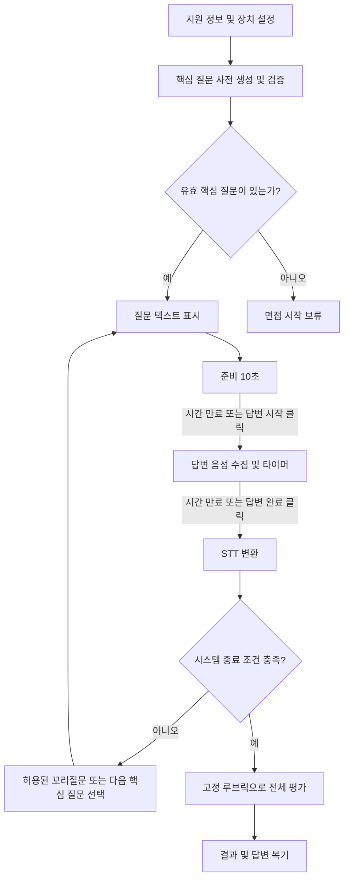

# AI 모의면접 시뮬레이터 — MVP 기획 및 구현 명세

- 작성일: 2026-11-23
- 최종 수정일: 2026-11-24
- 버전: v0.16
- 형태: 개인 학습용 웹 애플리케이션, 향후 오픈소스 공개
- 프로젝트명: AI Interview Loop (가칭)

## 변경 이력

| 버전 | 날짜 | 변경 내용 | 변경 사유 |
|---|---|---|---|
| v0.16 | 2026-11-27 | MVP 질문 TTS를 제외하고 질문 텍스트 표시 즉시 준비 10초를 시작한다. | 낭독과 답변 녹음이 겹치지 않게 하고 준비 시간 만료 및 조기 답변 시 즉시 녹음을 시작하기 위해서다. |
| v0.15 | 2026-11-24 | 제한된 자동 재시도와 미평가 처리를 확정하고 핵심 질문 5개를 생성 목표로 변경했다. | 질문 품질과 면접의 연속성을 우선하고 구현 복잡도를 줄이기 위해서다. |
| v0.14 | 2026-11-24 | 제시 전 필터에서 차단된 꼬리질문도 같은 검증 목적을 유지해 다시 생성하도록 확정했다. | 추가 검증이 필요하다고 판단한 내용을 면접에서 확인하기 위해서다. |
| v0.13 | 2026-11-24 | 제시 전 필터에서 차단된 핵심 질문은 같은 평가 영역의 대체 질문으로 교체하도록 확정했다. | 부적절한 질문을 차단하면서 핵심 질문 5개의 영역별 구성을 유지하기 위해서다. |
| v0.12 | 2026-11-24 | 사용자용 질문 건너뛰기를 제외하고 제시 전과 평가 전 질문 필터링을 추가했다. | 실전 면접 흐름을 유지하고 부적절한 질문이 점수에 영향을 주지 않도록 하기 위해서다. |
| v0.11 | 2026-11-24 | 평가할 답변이 0개인 경우의 안내와 처리 방식을 명시했다. | 답변 근거 없이 점수나 피드백이 생성되는 것을 방지하기 위해서다. |
| v0.10 | 2026-11-24 | 건너뛴 질문의 채점 제외와 평가 범위 표시를 확정했다. | 사용자가 부적절한 질문을 건너뛰어도 점수에 불이익이 없고, 결과에서 평가 범위를 확인할 수 있도록 하기 위해서다. |
| v0.9 | 2026-11-24 | 질문 건너뛰기 시 즉시 진행하고 질문과 건너뛰기 여부만 로컬에 기록하도록 변경했다. 사유 입력과 외부 피드백 전송을 제외했다. | 면접 흐름을 방해하지 않고 개인정보의 불필요한 외부 전송을 막기 위해서다. |
| v0.8 | 2026-11-24 | 수동 종료 후 요청형 피드백과 질문 건너뛰기 사유 수집을 추가했다. | 원하는 경우에만 조기 종료 피드백을 받고, 건너뛴 사유를 질문 품질 개선에 활용하기 위해서다. |
| v0.7 | 2026-11-24 | 문답 단위 로컬 영속 저장과 재시작 후 최종 평가 재시도를 확정했다. | 진행 중 오류로 인한 답변 유실을 줄이고 평가 실패와 면접 기록을 분리하기 위해서다. |
| v0.6 | 2026-11-24 | API 키 수명을 백엔드 프로세스 실행 기간으로 변경했다. | 면접 종료 후 평가 재시도와 새 면접에서 키를 재사용할 수 있도록 하기 위해서다. |
| v0.5 | 2026-11-24 | 로컬 웹 실행, localhost 접속, 개인 API 키의 백엔드 세션 메모리 보관을 확정했다. 공개 웹 서비스 배포와 데스크톱 패키징을 제외했다. | 개인 면접 연습용 MVP의 실행 환경과 키 보관 범위를 명확히 하기 위해서다. |
| v0.4 | 2026-11-24 | 면접관 이미지·아바타를 제외하고 질문 표시와 TTS 전달, 진행 정보 노출 기준을 구체화했다. 파형 대신 실시간 음량 바와 저음량 안내를 정의했다. | 질문과 답변에 집중할 수 있도록 화면을 단순화하고, 면접을 중단하지 않고도 마이크 입력을 확인하고 조정할 수 있도록 하기 위해서다. |
| v0.3 | 2026-11-24 | 핵심 질문 5개 사전 생성과 동적 꼬리질문을 결합하고, 질문 수 사용자 설정을 제외했다. 100점 고정 루브릭과 근거 검증 요구사항을 추가했다. | 모든 핵심 영역을 다루면서 답변에 필요한 추가 검증을 수행하고, 일관된 기준과 실제 근거로 결과를 복기할 수 있도록 하기 위해서다. |

## 1. 배경 및 목적

기존의 고정 질문형 영상 면접을 경험하면서, 제한 시간 안에 답변하는 환경이 실전 감각을 높이는 데 도움이 된다는 점을 발견했다. 그러나 사전에 정해진 질문만 순서대로 제공하는 방식은 답변에 따라 달라지는 실제 면접의 흐름을 충분히 재현하지 못한다.

지원자가 자신의 지원 자료를 기반으로 AI 면접관과 음성 면접을 진행하고, 직전 답변에서 파생된 꼬리질문에 대응하며, 종료 후 답변 텍스트와 피드백을 복기할 수 있는 최소 기능 제품을 제작한다.

**핵심 가설:** 시간 제한을 갖춘 음성 면접 환경에서 개인화된 동적 꼬리질문을 연습하면, 혼자 원고를 읽거나 고정 질문에 답하는 것보다 실제 면접 대응 역량을 훈련하기 좋다.

## 2. 핵심 사용자 및 사용 시나리오

- 대상: 취업 또는 교육기관 면접을 준비하는 개인 지원자
- 초기 사용자: 개발자 본인
- 사용 환경: 사용자 PC에서 Spring Boot 백엔드와 웹 프런트엔드를 실행하고 데스크톱 브라우저에서 `localhost`로 접속한다. 마이크를 사용한다(카메라 미사용). [ADR-0001](adr/0001-local-web-application.md)
- 1차 범위: 한국어 자기소개서 및 기업·직무 조사 자료 기반 일반 면접. 직무 및 경험 검증 질문 포함

사용자는 자기소개서와 기업·직무 조사 자료를 파일로 첨부하고, 필요시 포트폴리오를 추가한다. 자신의 AI API 키를 설정한 후 면접을 시작한다. 질문 텍스트가 표시되는 순간부터 최대 10초간 준비한다. 준비 중 언제든 ‘바로 답변’을 누르거나 준비 시간이 끝나면 음성 답변이 시작된다. 답변 제한 시간은 기본 60초이며, 시간 만료 전에 ‘답변 완료’를 눌러 마칠 수 있다. 면접 시작 전에 첨부 자료로 핵심 질문을 최대 5개 준비하고, 진행 중에는 답변을 추가로 확인할 필요가 있을 때 꼬리질문을 생성한다. 면접 종료 후 답변 텍스트, 고정 루브릭 점수, 평가 근거와 개선점을 확인한다.

## 3. MVP 기능 요구사항

| ID | 기능 | 구현 범위 및 완료 기준 |
|---|---|---|
| F01 | 지원 자료 등록 | 자기소개서(문항·답변 포함)와 기업·직무 조사 자료는 필수, 포트폴리오는 선택 파일로 등록한다. PDF(텍스트 추출 가능), Markdown, TXT를 지원한다. 직접 텍스트 입력은 불가하며 필수 파일 누락 또는 추출 실패 시 재첨부를 안내한다. |
| F02 | 맞춤 질문 | 면접 시작 전에 첨부 자료에 근거한 핵심 질문 5개를 목표로 생성하고, 유효한 질문이 하나 이상이면 시작한다. 웹 검색이나 자체 기업 조사를 하지 않는다. |
| F03 | AI 면접관 | 현재 질문을 텍스트로 표시하는 즉시 10초 준비를 시작한다. 질문 텍스트는 답변이 끝날 때까지 유지한다. |
| F04 | 타이머 | 준비 시간은 10초, 답변 제한 시간은 기본 60초(선택 60/90/120초). 준비 시간 만료 또는 ‘바로 답변’ 클릭 시 즉시 답변 타이머와 음성 수집을 시작한다. 답변 시간 만료 또는 ‘답변 완료’ 클릭 시 즉시 음성 수집을 끝내고 STT 단계로 전환한다. |
| F05 | 답변 음성 수집 및 STT | 마이크 권한을 확인하고 답변 구간의 음성만 수집하여 STT로 변환한다. 변환 성공 후 앱 내부 임시 음성을 삭제한다. 면접 전과 답변 중에는 실시간 음량 바를 제공하고, 답변 중 지속적인 저음량을 안내한다. |
| F06 | 동적 꼬리질문 | AI가 답변을 참고해 추가 검증이 필요할 때만 꼬리질문을 생성한다. 시스템이 핵심 질문당 최대 2개, 전체 최대 10개의 꼬리질문과 전체 최대 15개의 질문을 통제한다. |
| F07 | 결과 및 복기 | 면접 종료 후 질문별 답변 텍스트, 고정 루브릭 점수, 답변 근거와 함께 강점 및 개선점을 표시한다. |

### 3.1 첨부 자료 정책

| 자료 | 필수 여부 | 포함 내용 |
|---|---|---|
| 자기소개서 | 필수 | 실제 지원서의 문항과 답변 전체 |
| 기업·직무 조사 자료 | 필수 | 지원 기업/기관명, 직무/트랙명, 채용공고 또는 모집요강과 조사한 기업·직무 정보 |
| 포트폴리오 | 선택 | 프로젝트, 기술 경험, 성과 |

- 기업·직무 조사 자료는 하나 또는 복수 파일로 첨부할 수 있다.
- 기업명과 직무명은 첨부 자료에서 추출하여 사용자가 확인한다. 자료가 부족하거나 불일치하면 재첨부를 안내한다.
- 지원 자료는 파일로만 입력하며 스캔 PDF OCR, 외부 URL 자동 수집은 제외한다.
- AI API 키 입력은 지원 자료 입력과 별개인 서비스 설정이다.

## 4. 화면 구성

### 4.1 면접 설정 화면

- 자기소개서 및 기업·직무 조사 자료 필수 파일 첨부
- 포트폴리오 선택 파일 첨부
- 추출한 기업·직무 정보 확인
- 사용자 AI API 키 설정
- 답변 제한 시간 선택(60/90/120초, 기본 60초)
- 마이크 권한 확인과 실시간 음량 바를 통한 입력 상태·음량 점검
- 면접 시작 버튼

### 4.2 면접 진행 화면

- 현재 질문 텍스트를 답변이 끝날 때까지 표시한다.
- 현재 질문 번호만 표시. 전체 질문 수, 남은 질문 수, 핵심·꼬리질문 구분은 표시하지 않는다.
- 현재 단계(준비 / 답변 / 분석)와 남은 준비·답변 시간. 질문 오른쪽에 준비 타이머를 초 단위로 표시하며, 준비 시간 3·2·1초에 타이머 배경의 빨강을 단계적으로 짙게 표시한다. 타이머 아래에 마이크 음량 바를 배치하고 준비와 답변 중 같은 위치에 유지한다.
- 답변 중 실시간 음량 바, 최소 권장 음량 기준선, 지속 저음량 안내
- 타이머 아래 버튼에 준비 중에는 ‘바로 답변’, 답변 중에는 ‘답변 완료’를 표시한다. 그 아래에 ‘면접 종료’를 배치한다.
- 음성 수집 상태 표시, 면접 종료 버튼
- 면접 중 모범답안·평가·힌트 미노출

### 4.3 결과 화면

- 질문 및 STT 답변 텍스트
- 고정 루브릭에 따른 점수, 답변 근거와 연결된 강점·개선점
- 평가에 사용된 답변 범위(예: ‘5개 중 4개 답변’)
- 전체 개선 우선순위 최대 3개
- 새 면접 시작, 이전 면접 기록 열람·삭제, 정상 종료된 면접의 실패한 최종 평가 재요청
- 수동 종료한 면접의 피드백 요청

### 4.4 마이크 입력 품질 관리

- 면접 시작 전 마이크가 입력을 받고 있는지와 입력 음량을 실시간 음량 바로 점검한다. 답변 중에도 음량 바를 표시하며, 두 화면 모두 최소 권장 음량 기준선을 제공한다.
- 답변 중 음량이 기준선 미만으로 일정 시간 지속되면 안내한다. 예시 문구는 “마이크 입력이 작습니다. 조금 더 큰 목소리로 답변해 주세요.”다. 순간적인 음량 변화와 자연스러운 발화 사이의 짧은 침묵에는 경고하지 않는다.
- 정상 음량으로 회복되면 경고를 자동 해제한다. 경고 중에도 면접 진행과 타이머는 계속된다.
- 음량은 별도 AI API 호출 없이 클라이언트에서 측정하며 평가 점수에 반영하지 않는다. 기준값, 측정 방식, 경고 발생 및 해제 조건은 설계 단계에서 정한다.

## 5. 사용자 흐름 및 상태 관리

- 면접 진행과 평가 생성은 독립적인 상태로 관리한다. 면접 진행은 설정, 질문, 준비, 답변, STT, 다음 질문, 종료 또는 오류 중단을 다룬다. 평가 생성은 요청, 성공, 실패와 재시도를 별도로 다룬다.
- 첫 질문 표시 전에 핵심 질문 5개를 목표로 준비한다. 유효한 핵심 질문이 0개면 시작하지 않는다. 진행 중 핵심 질문은 원칙적으로 유지한다.
- 시스템이 핵심 질문별 꼬리질문 수, 전체 꼬리질문 수와 전체 질문 수를 제한한다. 꼬리질문으로 남은 핵심 질문이 누락되지 않도록 진행한다.
- 정상 흐름에서는 유효한 핵심 질문과 허용된 꼬리질문을 모두 마치고 남은 질문 후보가 없으면 면접을 종료한다. 오류로 중단된 면접은 저장된 문답을 열람할 수 있으며 이어하기와 부분 평가는 제공하지 않는다. 사용자가 직접 종료하면 자동으로 평가를 요청하지 않는다. 사용자가 피드백을 요청하면 그 시점까지 저장된 문답을 바탕으로 생성한다.
- 각 단계에서 타이머 만료와 버튼 클릭이 겹쳐도 답변 시작과 답변 종료는 각각 한 번만 처리한다.
- 질문 생성은 자동 재시도 정책을 적용한다. 그 밖의 STT/LLM 오류가 발생하면 해당 단계의 재시도 또는 명시적 건너뛰기를 제공한다. STT 재시도 시에만 임시 음성을 잠시 유지하고 성공·건너뛰기·세션 종료 시 삭제한다. 기존 답변 텍스트는 유지한다.

## 6. AI 처리 정책

### 6.1 질문 생성

핵심 질문 사전 생성과 답변 기반 동적 꼬리질문을 결합한다. 핵심 질문과 꼬리질문 모두 가급적 1~2문장으로 간결하게 작성하고, 한 번에 하나의 핵심 내용만 질문한다.

| 핵심 질문의 평가 영역 | 목표 문항 수 |
|---|---:|
| 지원 동기 | 1 |
| 기업·직무 이해도 | 1 |
| 직무 역량 및 프로젝트 경험 | 2 |
| 협업 및 문제 해결 경험 | 1 |
| 합계 | 5 |

- 핵심 질문은 면접 시작 전에 자기소개서, 기업·직무 조사 자료 및 선택 포트폴리오의 추출 텍스트를 근거로 생성하며, 시작 후 원칙적으로 유지한다.
- 꼬리질문은 연결된 핵심 질문, 현재 질문, 직전 STT 답변, 첨부 자료와 이전 문답을 참고한다. AI는 주장, 개인 기여, 기술 선택 이유 등에 추가 검증이 필요한지 판단하고, 필요할 때만 한 번에 하나를 생성한다. 이미 충분히 설명된 내용은 반복하지 않는다.
- 시스템은 핵심 질문당 꼬리질문 0~2개, 전체 꼬리질문 최대 10개, 전체 질문 최대 15개를 적용하고 종료 조건을 통제한다. 꼬리질문이 없거나 허용 한도에 도달하면 다음 핵심 질문으로 진행하거나 남은 핵심 질문이 없는 경우 종료한다.
- 기업·직무 질문은 첨부 자료에 근거한다. 외부 검색을 수행하거나 자료에 없는 사실과 상충하는 정보를 임의로 단정하지 않는다. 면접 중 모범답안·칭찬·평가·힌트를 노출하지 않는다.
- STT 결과가 비어 있거나 신뢰하기 어려우면 답변 내용을 지어내지 않는다. 재질문과 다음 핵심 질문으로의 진행 조건, 재질문의 수 제한 반영 방식은 설계에서 정한다.
- 답변 수집 종료 후 STT를 수행하고, 필요 시 LLM으로 꼬리질문을 생성한 뒤 다음 질문을 텍스트로 표시한다.

- 핵심 질문과 꼬리질문을 화면에 표시하기 직전에 질문 적합성을 확인한다. 필터에서 부적절하다고 판정한 질문은 제시하지 않는다. 핵심 질문이 차단되면 같은 평가 영역에서 대체 질문을 생성하고 필터를 통과한 뒤 제시한다. 꼬리질문이 차단되면 같은 핵심 질문과 답변에 대해 확인하려던 내용을 유지해 대체 꼬리질문을 생성한다. 대체 꼬리질문도 제시 전에 필터를 통과해야 한다.
- 두 유형 모두 생성 실패나 필터 차단으로 자동 재시도 한도까지 유효한 질문을 확보하지 못하면 해당 질문을 제외하고 사용자 개입 없이 다음 질문 또는 종료 단계로 진행한다. 제외한 질문은 질문 수와 채점 대상에 포함하지 않는다. 재시도 한도의 값은 후속 검토한다. [ADR-0007](adr/0007-question-generation-recovery.md)

### 6.2 평가

정상 종료된 면접은 시스템의 동일한 고정 루브릭으로 평가한다. 수동 종료된 면접에는 사용자가 요청한 경우에만 저장된 문답을 바탕으로 피드백을 제공한다.

| 평가 항목 | 배점 | 평가 기준 |
|---|---:|---|
| 질문 적합성 | 20 | 질문의 의도에 부합하는 답변인가? |
| 논리적 구성 | 20 | 주장과 근거가 논리적으로 연결되는가? |
| 구체성 및 근거 | 25 | 경험과 행동을 구체적인 근거로 설명하는가? |
| 직무 적합성 | 20 | 지원 직무와 관련된 역량을 보여주는가? |
| 간결성 | 15 | 제한 시간 내 핵심 내용을 전달하는가? |
| 합계 | 100 | |

- 점수와 함께 질문별 강점, 개선점, 실제 답변에 기반한 평가 근거와 전체 개선 우선순위 최대 3개를 제공한다. 직무 적합성은 첨부한 기업·직무 자료를 근거로 평가한다.
- 마이크 입력 음량과 표정·외모·성격·감정·시선·자세 등 비언어적 요소는 평가 점수에 반영하지 않는다. STT 오인식 가능성을 고려하고 불확실한 내용은 단정하지 않으며, 실제 채용 합격 여부는 예측하지 않는다.
- 평가 전에 이미 제시된 질문의 적합성을 다시 확인한다. 부적절하다고 판정한 질문과 해당 답변을 채점 대상에서 제외하고 그 문항을 이유로 감점하지 않는다. 결과 화면에는 실제 평가에 사용된 답변 범위를 표시한다.
- 평가할 답변이 0개이면 AI 평가·피드백을 호출하거나 점수를 표시하지 않는다. 저장된 기록이 있으면 보여주고 ‘평가할 답변이 없습니다’라고 안내한다.
- 질문 부족으로 검증하지 못한 평가 영역은 미평가로 표시한다. 미평가 영역의 점수 집계 방식은 후속 검토한다.
- 미응답 및 평가 근거 부족 항목의 처리 방식, 채점 단위와 세부 점수 산정 방식은 추후 설계한다.
- 동일한 입력을 반복 평가해 기준 적용과 점수의 일관성을 비교하고, 평가 근거를 원래 답변과 첨부 자료에 대조해 정확성을 확인할 수 있도록 설계한다. 허용 편차와 판정 방식은 추후 정한다.
- 입력 문서는 참고 데이터이며, 문서 내부 지시문을 면접관 시스템 지시로 실행하지 않는다.

## 7. 최소 구현 구조 (권장)

기존 저장소가 있다면 기존 기술 스택과 규칙을 우선한다. 신규 프로젝트라면 개발자가 빠르게 구현할 수 있는 단일 웹 애플리케이션 구조를 우선하며, 마이크로서비스나 별도 인프라는 도입하지 않는다.

| 구성 요소 | 역할 |
|---|---|
| 웹 UI | 면접 설정, 파일 첨부, 음성 수집 상태, 타이머, 결과 화면 |
| 브라우저 Media API | 마이크 접근, 클라이언트 음량 측정 및 임시 답변 음성 수집 |
| 서버 API | 문서 텍스트 추출, STT·LLM 호출 및 오류 처리 |
| AI 어댑터 | STT, 질문 생성, 평가 기능을 분리해 구현 |
| 면접 기록 저장 | STT 완료 문답 및 평가에 필요한 기업·직무 자료와 적용한 평가 기준을 로컬 영속 저장한다. 저장 기술은 후속 검토한다. |

Spring Boot 백엔드는 사용자의 개인 API 키로 외부 AI API를 호출한다. 키는 백엔드 프로세스 메모리에 보관한다. 면접이 끝나거나 평가에 실패해도 유지하며, 사용자가 키를 직접 제거하거나 백엔드를 종료하면 사라진다. 코드·로그·영구 저장소에 기록하지 않는다. AI 호출 비용은 사용자가 부담한다. 키 전달 방법은 후속 설계에서 정한다. [ADR-0006](adr/0006-process-lifetime-api-key.md)

첨부 문서의 추출 텍스트와 STT용 음성의 외부 AI 공급자 전송 여부를 면접 시작 전에 안내한다. 앱 내부 임시 음성은 STT 완료 후 삭제하고, 외부 공급자의 데이터 보관 정책은 별도 안내한다. 세션 삭제 기능을 제공하고 `localhost`로 접속한 브라우저에서 마이크를 사용한다.

### 7.1 면접 기록과 최종 평가 재시도

- STT가 완료될 때마다 질문과 답변을 저장한다. 최종 평가 요청 전 기록과 평가 입력의 저장을 완료한다. 원본 음성은 STT 완료 후 삭제하고 API 키는 영속 저장하지 않는다.
- 오류 중단 시 이미 저장된 문답을 보존한다. 정상 종료 후 최종 평가가 실패하면 기록을 기반으로 평가만 다시 요청할 수 있다. 백엔드 재시작 후에도 이전 기록을 열람·삭제할 수 있고, 키를 다시 입력해 평가를 재요청할 수 있다. [ADR-0005](adr/0005-interview-record-and-evaluation-retry.md)

## 8. MVP 제외 범위

- 공개 웹 서비스 배포 및 데스크톱 응용 프로그램 패키징
- 질문 음성 합성 및 재생(TTS)
- 카메라 접근, 사용자 영상 표시, 영상 녹화·재생·다운로드
- 자동 기업·직무 조사, 웹 검색, 채용공고 크롤링
- 지원 자료 직접 텍스트 입력, 이미지 PDF OCR
- 면접관 이미지와 아바타, 립싱크, 3D 캐릭터 애니메이션
- 마이크 입력의 음성 파형 시각화
- 감정·표정·시선 분석 및 영상 기반 자동 채점
- 회원가입, 로그인, 결제, 다중 사용자 서비스
- 학습 이력 대시보드, 장기 성장 분석, 랭킹
- 기업별 평가 기준 수집, 실제 면접 기출문제 데이터베이스
- 오류로 중단된 면접 이어하기 및 부분 평가
- 질문 수 사용자 설정 및 사용자용 질문 건너뛰기
- 면접 기록 내보내기·공유, 외부 품질 피드백 수집
- 사용자 정의 루브릭 첨부, 기업·직무별 평가 루브릭 프리셋, 면접 유형별 평가 기준, 평가 항목 및 배점 사용자 설정
- RAG, 벡터 DB, 실시간 음성 스트리밍
- PT 면접·압박 면접·외국어 면접별 별도 프리셋 (확장 단계)

## 9. 구현 순서

1. 면접 설정 화면과 상태 전환 및 타이머 구현
2. 마이크 권한 확인, 실시간 음량 표시와 저음량 안내, 임시 답변 음성 수집 및 삭제 구현
3. 필수·선택 지원 자료 파일 첨부 및 텍스트 추출, 핵심 질문 사전 생성과 시작 조건 검증 및 질문 표시
4. STT, 문답 단위 로컬 영속 저장, 답변 기반 꼬리질문 및 시스템 진행 제어와 질문 생성 실패 복구 연결
5. 면접 종료 후 고정 루브릭 평가, 평가 재시도 및 면접 기록 열람·삭제 구현
6. 예외 처리 및 기본 시나리오 테스트, README에 실행 방법 문서화

## 10. MVP 완료 조건

- [ ] 자기소개서(문항·답변 포함) 및 기업·직무 조사 자료를 파일로 등록해야 시작할 수 있다. 포트폴리오 없이도 진행할 수 있다.
- [ ] 필수 파일 누락 또는 추출 실패 시 재첨부를 안내한다. 직접 텍스트 입력은 미지원한다.
- [ ] 사용자 PC에서 Spring Boot 백엔드와 웹 프런트엔드를 실행하고 브라우저에서 `localhost`로 접속해 마이크 권한을 확인할 수 있다.
- [ ] 개인 API 키를 백엔드 메모리에 보관해 외부 AI API를 호출한다. 면접 종료 및 평가 실패 후에도 키가 유지되고, 직접 제거하거나 백엔드를 재시작하면 기존 키를 다시 사용할 수 없다.
- [ ] 지원 자료 기반 질문을 텍스트로 전달한다. 질문은 한 번에 하나의 핵심 내용을 묻고 가급적 1~2문장으로 제시한다. 질문 텍스트는 답변 종료까지 유지된다.
- [ ] 진행 화면은 현재 질문 번호, 단계, 남은 준비·답변 시간을 표시한다. 면접관 이미지·아바타, 전체·남은 질문 수, 핵심·꼬리질문 구분은 표시하지 않는다.
- [ ] 면접 전과 답변 중에 기준선이 있는 실시간 음량 바를 확인할 수 있다. 답변 중 지속적인 저음량에는 경고하고, 순간적인 변동이나 짧은 침묵에는 경고하지 않는다. 정상 음량으로 회복되면 자동 해제되며, 경고 중에도 진행과 타이머는 계속된다.
- [ ] 음량 측정은 클라이언트에서 수행하고 별도 AI 호출이 없다. 음량을 평가 점수 산정에 사용하지 않는다.
- [ ] 질문 텍스트가 표시되는 순간 10초 준비가 시작되고, 준비 시간 만료 또는 ‘바로 답변’ 클릭 즉시 답변 타이머와 음성 수집이 시작된다.
- [ ] 답변 제한 시간 기본값은 60초다. 답변 시간 만료 또는 ‘답변 완료’ 클릭 즉시 음성 수집이 끝나고 STT로 전환된다. 각 단계에서 버튼 클릭과 시간 만료가 겹쳐도 전환은 한 번만 일어난다.
- [ ] 답변 구간의 음성이 STT로 변환되고 처리 완료 후 앱 내부 임시 음성이 삭제된다. 카메라를 사용하지 않는다.
- [ ] 기업·직무 질문은 첨부 자료를 근거로 생성하고 외부 검색을 하지 않는다.
- [ ] 답변에 따라 달라지는 꼬리질문이 최소 한 번 이상 정상 생성된다.
- [ ] 영역별 1·1·2·1개를 목표로 핵심 질문을 준비한다. 유효한 핵심 질문이 1~4개여도 진행하고, 0개면 시작하지 않는다. 질문 수 설정은 제공하지 않는다.
- [ ] 충분한 답변에는 꼬리질문을 생략하고, 추가 검증이 필요할 때 생성한다. 시스템이 핵심 질문당 최대 2개, 전체 꼬리질문 최대 10개, 전체 질문 최대 15개를 지키며 유효한 핵심 질문이 꼬리질문으로 인해 누락되지 않는다.
- [ ] 정상 종료 후 평가가 성공하면 질문별 답변 텍스트와 100점 고정 루브릭 점수, 답변 근거 및 개선점을 확인할 수 있다.
- [ ] 수동 종료 시 자동으로 평가를 호출하지 않고, 사용자가 요청하면 저장된 문답을 바탕으로 피드백을 제공한다.
- [ ] 핵심 질문과 꼬리질문은 화면 표시 직전에 필터링하며, 부적절하다고 판정한 질문은 제시하지 않는다. 차단된 핵심 질문은 같은 평가 영역에서, 차단된 꼬리질문은 같은 검증 목적에 맞춰 다시 생성한다. 대체 질문도 제시 전 필터를 통과해야 한다.
- [ ] 두 유형 모두 재시도 한도를 소진하면 실패한 질문을 수와 채점에서 제외하고 자동으로 진행한다. 질문 부족으로 검증하지 못한 영역은 미평가로 표시한다.
- [ ] 평가 전 재검토에서 부적절하다고 판정한 문항과 해당 답변은 감점 없이 채점에서 제외한다. 결과에 실제 평가 범위가 표시된다.
- [ ] 저장된 답변이 없거나 평가 전 필터링으로 채점 대상 답변이 0개이면 AI 채점·피드백을 호출하지 않고 점수 없이 안내한다. 저장된 기록이 있으면 열람할 수 있다.
- [ ] STT 완료 문답은 오류 중단이나 백엔드 재시작 뒤에도 열람·삭제할 수 있다. 오류로 중단된 면접의 이어하기와 부분 평가는 제공하지 않는다.
- [ ] 정상 종료 후 평가가 실패하면 백엔드를 재시작한 뒤에도 키를 다시 입력하고 저장된 문답·기업 및 직무 자료·평가 기준으로 최종 평가만 재요청할 수 있다.
- [ ] 동일한 입력의 반복 평가로 일관성을 비교할 수 있고, 평가 근거가 해당 답변에 있는지와 직무 적합성 평가가 첨부 자료에 근거하는지 검증할 수 있다.
- [ ] 장치 권한 거부, 빈 답변, AI 호출 실패, 시간 만료의 예외 상황에서 안내가 제공된다.
- [ ] 세션 삭제가 가능하고 API 키가 코드·로그·영구 저장소에 남지 않는다.
- [ ] README만으로 로컬 실행 방법을 이해하고 재현할 수 있다.

## 11. 검증 목표 및 공개 원칙

최초 사용자인 개발자가 실제 면접 연습에 사용하면서 다음을 확인한다. 수치는 개발 후 측정하며 성과를 사전에 단정하지 않는다.

- 시간 제한이 실전 긴장감과 간결한 답변 훈련에 도움이 되는가?
- 첨부 기업·직무 자료에 근거한 질문이 실제 지원 직무와 부합하는가?
- 꼬리질문이 직전 답변과 실질적으로 연결되는가?
- 답변 근거가 있는 피드백이 다음 연습에서 개선할 행동을 제시하는가?
- AI 호출 대기 시간이 면접 흐름을 과도하게 방해하지 않는가?

오픈소스 공개 시 독자적인 명칭과 이미지, 자체 생성 문제를 사용한다. 비공개 기출문제, 타 기관의 공식 로고 및 기사 원문을 무단 배포하지 않으며, 샘플 자료에는 가상의 개인정보를 사용한다. 소스코드 라이선스는 의존성 및 외부 자산 조건을 확인한 뒤 결정한다.