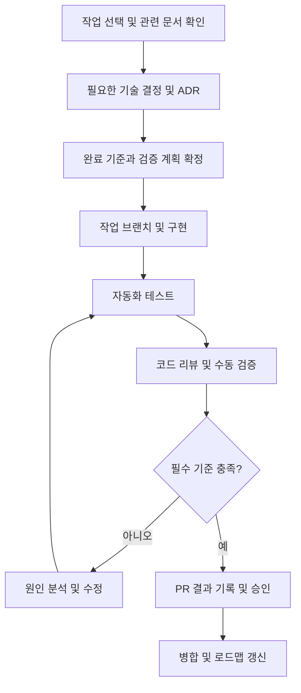

# 개발 검증 가이드

## 1. 목적

기능이 요구사항과 확정된 ADR을 만족하는지 확인하고, AI가 작성한 코드의 품질과 한계를 개발자가 판단할 수 있도록 한다. 1인 MVP에 맞춰 검증은 작업의 위험도와 규모에 비례해 수행한다.

## 2. 전체 흐름

중요한 기술 결정이 없으면 ADR 없이 진행한다. 새 설계 결정이 필요한 경우 구현을 보류하고 논의한다.

## 3. 구현 전: 검증 계획

기획서, 로드맵, 관련 Accepted ADR에서 요구사항을 확인한다. AI가 아래 내용을 제안하고 개발자가 기대 동작 및 완료 기준을 검토한다. 이미 승인된 기준은 재사용한다.

| 항목 | 기록 내용 |
| --- | --- |
| 요구사항 | 검증할 기능과 관련 ADR |
| 정상 흐름 | 입력·조건 및 기대 결과 |
| 예외 흐름 | 오류·실패 상황과 기대 결과 |
| 경계 조건 | 최소·최대·빈 입력·시간 제한 등 해당되는 조건 |
| 검증 방법 | 단위·통합·E2E·수동 검증 중 적합한 방법 |
| 완료 기준 | 반드시 만족해야 하는 조건과 보류 가능한 항목 |

예시: 꼬리 질문의 재생성 한도에 도달하면 해당 질문을 제외하고 다음 핵심 질문으로 이동해야 한다. 단순히 메서드가 실행되는지가 아니라 이러한 동작을 검증한다.

계획은 작업 요청 또는 PR에 기록할 수 있다. 기능마다 별도의 검증 문서를 만들지 않는다.

## 4. 구현 및 자동화 테스트

기능 코드와 테스트 코드를 함께 작성한다. 테스트를 구현보다 먼저 작성하는 TDD는 선택 사항이며, 구현 전 기대 결과를 정하는 것은 필수다.

| 종류 | 적용 대상 |
| --- | --- |
| 단위 테스트 | 상태 전이, 계산, 횟수 제한 등 독립 로직 |
| 통합 테스트 | API, 저장소, 서비스 간 연동 및 오류 처리 |
| E2E 테스트 | 핵심 사용자 흐름 |
| 회귀 테스트 | 수정 사항이 기존 동작을 깨뜨리지 않는지 확인 |

모든 작업에 모든 종류를 강제하지 않는다. 변경된 로직, 주요 의존성 및 기존 기능에 미치는 영향을 고려해 검증한다. 테스트는 기대값과 실패 조건을 명시하고, 테스트가 항상 통과하도록 실제 오류를 숨기거나 기대값을 임의 변경하지 않는다.

AI 연동은 다음을 구분한다.

- Mock: 정상·비정상 AI 응답을 이용해 애플리케이션의 제어 흐름, 저장, 재시도, 실패 처리를 검증한다.
- 실제 AI: 질문 관련성, 근거 일치, 후속 질문 적절성, 평가 일관성 등 결과 품질을 별도로 검증한다. 테스트 데이터, 모델, 조건, 표본 수, 판정 기준과 한계를 기록한다.
- 실제 API 호출은 사용자의 승인과 설정이 있을 때만 수행하며, 실제 민감 자료나 API 키를 로그·테스트 파일·저장소에 남기지 않는다.

## 5. 개발자 리뷰 및 수동 검증

AI는 변경 파일, 핵심 로직, 관련 테스트, 예외 처리와 잔여 위험을 요약하고 검증 절차를 제공한다. 개발자는 다음을 확인한다.

- 요구사항·ADR 준수 여부와 주요 데이터 및 제어 흐름을 이해한다.
- 테스트가 요구사항의 기대 결과와 실패 조건을 제대로 확인하는지 검토한다.
- 불필요한 복잡도와 개인정보 노출 등 위험을 확인한다.
- 실행 명령과 테스트 통과·실패·미실행 결과를 확인한다.
- 필요한 주요 사용자 흐름을 직접 실행하고 마이크·타이머·화면 등 자동화하기 어려운 동작을 검증한다.
- 문제가 발견되면 재현 조건과 기대/실제 결과를 전달하고 수정 후 관련 테스트 및 회귀 검증을 수행한다.

모든 자동화 테스트를 직접 반복할 필요는 없다. AI가 수행한 검증을 개발자가 수행했다고 기록하지 않는다.

## 6. 결과 기록 및 완료

기존 PR 템플릿을 사용한다. 일반적인 검증 결과는 PR에, 독립적 비교 실험이나 성능·AI 품질 측정은 필요시에만 `docs/validation/`에 정리한다.

기록에 포함할 내용:

- 검증 대상 및 조건, 기대 결과, 실제 결과, 실행 명령 및 환경(필요 시).
- 상태: PASS / FAIL / NOT RUN / 해당 없음(사유 포함).
- 수동 검증 수행자, 발견된 문제와 수정·재검증 결과.
- 미해결·미검증 사항 및 영향, 관련 ADR·이슈 링크(존재할 때).

완료 조건:

- 필수 완료 기준과 관련 테스트를 충족하고, 필요한 수동 검증과 개발자 리뷰가 이루어졌다.
- 필수 검증이 실패 또는 미실행이면 완료 처리하지 않는다. 비필수 검증을 보류할 때에는 이유를 기록하고 개발자가 승인한다.
- PR에서 최종 승인받아 병합한 후 로드맵을 갱신한다. 실제 수행하지 않은 검증이나 측정 수치는 기록하지 않는다.

## 7. CI 도입

초기 작업부터 로컬에서 프로젝트의 빌드 및 테스트 명령을 확인한다. 첫 기능 구현 단계에서 GitHub Actions로 확장한다.

- 백엔드 및 프런트엔드의 빌드·자동화 테스트를 PR 및 `dev`·`main` 변경 시 실행한다.
- 프로젝트에 설정된 정적 검사·포맷 검사를 포함한다.
- 실제 AI API 호출은 기본 CI와 분리한다.
- 필수 검사 실패 시 병합을 제한한다. CI 구성 전에는 실제 실행 결과를 PR에 기록한다.

CI는 개발자 리뷰를 대체하지 않는다.

관련 문서: [Git 컨벤션](conventions.md), [AGENTS.md](../AGENTS.md).
